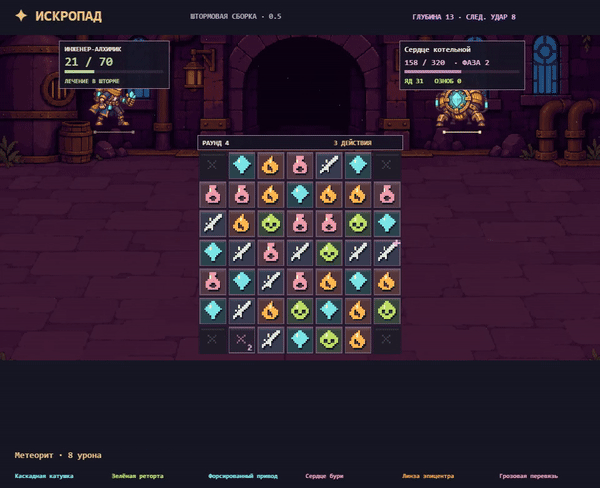
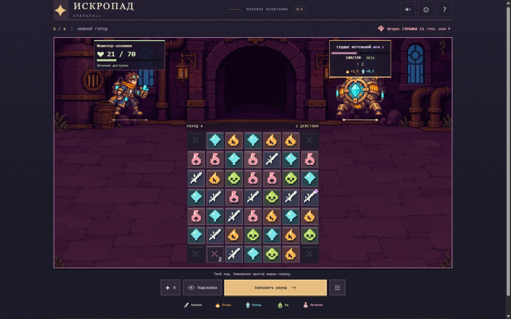
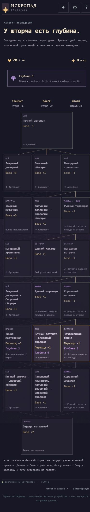
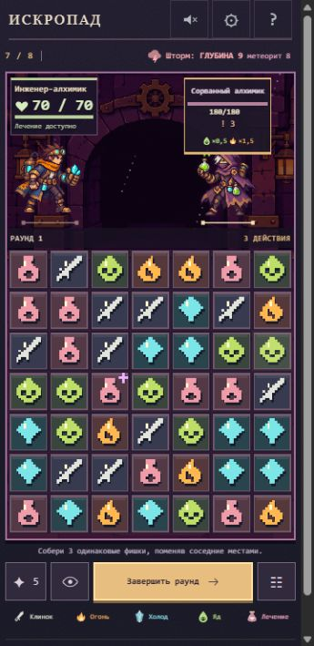
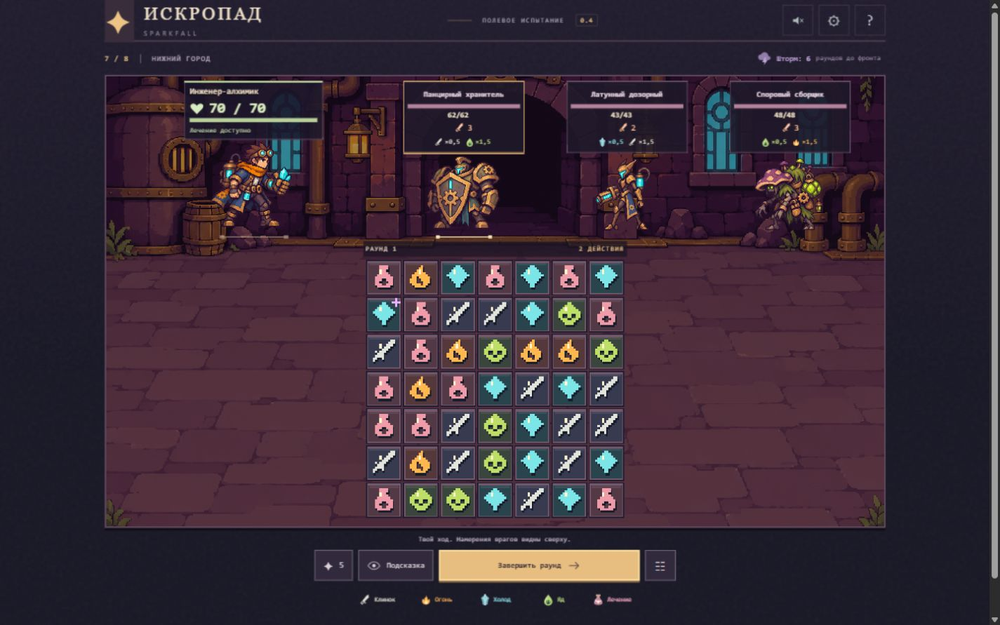

# Искропад / Sparkfall

Браузерный роглайт с боями через «три в ряд» в мире магических машин и алхимии. **Версия 0.5.0: настоящие развилки, глубина шторма, редкие трофеи элит и шесть новых артефактов. Пиксельная сцена Three.js с более выразительными атаками.**

**[Играть в браузере](https://lavrlistoviy.github.io/sparkfall/)** · [Репозиторий](https://github.com/LavrListoviy/sparkfall) · [План развития](TODO.md)

Один герой, восемь узлов с развилками, четыре обычных противника, две элиты, двухфазный босс, шестнадцать артефактов, пять событий, привал, три стартовых набора и шесть достижений. Между забегами открываются новые возможности без постоянного увеличения характеристик.

Шторм приближается после полного раунда: обычно два действия героя и ответ врагов. Форсированный привод даёт третье действие, но отнимает единицу отрыва при переходе. Глубина шторма растёт без предела, базовый урон метеорита — 4 → 6 → 8. Кратеров максимум три. Редкие артефакты позволяют лечиться, защищаться и усиливать урон внутри шторма. Босс при половине здоровья разрушает углы матрицы и меняет слабости.


## Посмотреть перед запуском

[](docs/media/gameplay.mp4)

**[Смотреть короткое видео — 31 секунда, MP4](docs/media/gameplay.mp4).** Записан настоящий рендерер Three.js на последовательности решений контрольного забега `PLAY-5`. Подписи для видео скомпонованы отдельно; результаты боя не изменены. GIF — короткий фрагмент записи.



| Выбор маршрута | Бой на узком экране |
| --- | --- |
|  |  |

## Что нового попробовать

Три полосы карты: **транзит +4**, **поиск +2**, **шторм +0** базового отрыва. Между слоями можно перейти только в соседнюю полосу. Перед входом видны состав, точный отрыв с артефактами и условия награды.

Если войти в бой с элитой уже внутри шторма и победить там же, появится выбор одного из трёх редких, ещё не взятых артефактов. Если шторм догонит в середине боя — награда обычная. Редкие предметы: Грозовая перевязь, Сердце бури, Заземляющая катушка, Линза эпицентра и Компас обратного ветра. Погодные встречи в шторме — Караван в пепле и Заземляющая башня.

## Запуск

Нужны Node.js 22 или новее и браузер с WebGL 2. Three.js 0.187.0 уже включён в `public/vendor/three/` с MIT-лицензией, поэтому для запуска `npm install` не требуется. Для обновления зависимостей разработчиком: `npm ci`, затем `npm run vendor`.

В Windows можно дважды нажать `start-game.cmd`, затем открыть **<http://localhost:4173/>**. Или из папки проекта:

```powershell
npm.cmd run dev
```

Сервер раздаёт только `public/`. Остановка — Ctrl+C. Другой порт: `npm.cmd run dev -- --port 4174`.

На компьютере работают два клика, перетаскивание и клавиатура; на телефоне предусмотрены два нажатия и свайп. Описание фишки, артефакта или сопротивления открывается нажатием. В окне `?` — правила. Кнопка ⚙ открывает скорость анимаций 0,5× / 1× / 2× и уменьшение движения. Уменьшение движения убирает выпады и тряску, сохраняя читаемые паузы; настройки запоминаются. Звук выключен по умолчанию.

Для телефона в той же локальной сети:

```powershell
npm.cmd run dev -- --host 0.0.0.0 --port 4175
```

Открыть на телефоне `http://<локальный IPv4 компьютера>:4175/`. Компьютер и телефон должны находиться в одной сети. Адрес можно посмотреть через `ipconfig`. Если Windows блокирует подключение, запустить PowerShell от администратора и выполнить `powershell -ExecutionPolicy Bypass -File .\scripts\allow-lan.ps1`. Правило разрешает только Node на TCP 4175 из локальной подсети в частной сети. Сервер работает, пока запущен процесс и компьютер не спит.

Публичная ссылка GitHub Pages работает независимо от локального сервера.

## Сохранение и отзывы

Сохранения 0.3/0.4 переносятся автоматически. Начатые экспедиции сохраняют прежние маршруты и правила до завершения. Для новых возможностей начни новый забег. Тройная встреча — в средней полосе седьмого узла.

Профиль и забег сохраняются одним снимком в `localStorage` **до анимации хода**. Перезагрузка не откатывает обмен и не перебрасывает награду. Искры забега переходят в профиль при победе, поражении или добровольном возвращении. Достижения начисляются сразу, по одному разу.

Профиль привязан к браузеру и адресу: `localhost`, `127.0.0.1`, IP компьютера и разные порты имеют отдельные сохранения. Приватный режим и очистка данных браузера не подходят для постоянного прогресса. При ошибке записи игра явно предупреждает; повреждённый файл можно выгрузить перед ручным сбросом.

Кнопка **«Оставить отзыв»** открывает форму: впечатление, ошибка или идея, текст и необязательный email для ответа. Отчёт о забеге прикладывается только по отдельной галочке; перед отправкой можно увидеть JSON. Форма передаёт данные через FormSubmit автору игры. Письма автоматически попадают под ярлык `Sparkfall / Feedback`, минуя входящие. Если сервис не ответил, текст остаётся в открытой странице; автоматических повторов нет.

Кнопка «Отчёт о забеге» также позволяет отдельно скопировать или скачать JSON. Скрытой аналитики и автоматической отправки игровых данных нет. Повторить отчёт:

```powershell
npm.cmd run replay -- docs/browser-playthrough.json
```

Новый браузерный проход 0.5.0: `PLAY-5`, штормовой маршрут, 48 обменов, победа с 41 HP на глубине 14; файл `docs/browser-playthrough-0.5.json`.

Контрольный браузерный проход 0.4.0: `ISKRA-01`, победа, 43 обмена, 58 HP; файл `docs/browser-playthrough-0.4.json`. Старый отчёт 0.3.0 также воспроизводится: 44 обмена, 68 HP. Seed нового забега можно задать через `?seed=PLAY-0`; существующий забег URL не перезаписывает.

## Проверки и сборки

```powershell
npm.cmd test
npm.cmd run simulate -- 10
npm.cmd run package
```

- 104 автоматических теста: поле, бой, артефакты, элиты, босс, маршрут, мета, миграция сохранений, граф маршрутов, глубина, редкость, погодные события, штормовые сборки, последовательность показа эффектов, обратная связь, переносимые пути и упаковка.
- 90 автоматических забегов: транзит 30/30 побед, поиск 19/30, шторм 15/30. Бот оценивает только видимые первые совпадения, не будущий RNG. Это проверка проходимости, не окончательный баланс.
- Проверки и практические сценарии — в [QA третьей итерации](docs/QA_ITERATION_3.md); результаты симуляций — `docs/simulation-0.5.json`.
- Физический телефон, мобильный Safari и производительность на слабом GPU требуют отдельного прогона.

`npm run package` готовит локальные каталоги `releases/sparkfall-0.5.0/web/` и `playtest/`. Каталог `web/` можно разместить на статическом HTTP-хостинге, в том числе в подпапке. Через `file://` модули не запускаются. Сборки создаются локально и не хранятся в Git.

## Публикация и поддержка

Push в `main` запускает `.github/workflows/pages.yml`: тесты → артефакт только из `public/` → GitHub Pages. Pull request запускает проверки без публикации. Секреты для сайта не нужны; email получателя заменён публичным идентификатором FormSubmit в `public/feedback-config.js`.

Для собственной копии проекта настрой свой FormSubmit, подтверди его письмом, замени endpoint в `feedback-config.js`. Сервис требует отдельной активации для нового адреса сайта, включая изменившийся локальный IP или порт. Фильтр Gmail: тема `[Sparkfall Feedback]`, применить нужный ярлык, пропустить входящие. После настройки отправь один тест и проверь фактическое письмо: ответ сервиса сам по себе не гарантирует доставку.

Воспроизведение видеодемо: `node scripts/prepare-demo.mjs`, запустить сервер, открыть `/_dev/demo.html`, нажать «Записать демонстрацию», затем скачать WebM. Этот временный каталог исключён из Git и переносимых сборок. Финальное видео — H.264 MP4 960×780, 30 fps; в `scripts/media/` сохранён воспроизводимый рекордер.

## Документы и устройство проекта

- **[Архитектура: как добавить артефакт или событие](docs/ARCHITECTURE.md).**
- [Концепт и требования](docs/SPEC.md), [правила первой итерации](docs/ITERATION_1.md), [контракт новой сцены](docs/ITERATION_2.md), [штормовые сборки и маршруты](docs/ITERATION_3.md), [публикация и отзывы](docs/ITERATION_4.md).
- [Правила разработки](AGENTS.md): сначала спецификация, затем TDD; [план работ](TODO.md).
- [План проверок](docs/TEST_PLAN.md), [фактический отчёт QA](docs/QA_ITERATION_1.md), [инструкция тестировщику](docs/PLAYTEST.md).
- [Пиксельные спрайты и арена](docs/ASSETS_PIXEL.md); прежние иллюстрации сохранены как материалы первой итерации.
- `public/core/` — детерминированное ядро без DOM; `content.js` содержит числа и контент.
- `public/presentation/` — сцена Three.js, геометрия, шкала времени, текстуры и настройки.
- `public/app.js` — ввод, сохранение, синхронизация HUD, звук; `views.js` — экраны экспедиции.
- `test/` — проверки требований; `scripts/` — сервер, упаковка, симуляция и воспроизведение.

Баланс пока щадящий: важнее проверить решения и сочетания артефактов. Продолжительность человеческих забегов и интерес повторных попыток предстоит измерить с друзьями. Добавлять контент до этого рано.


