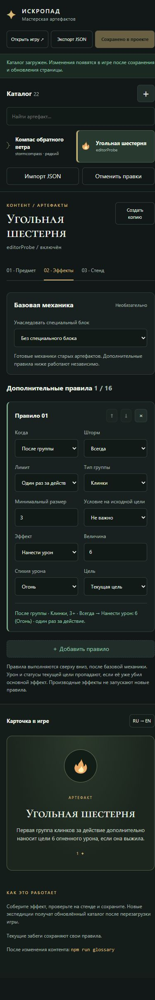

# Мастерская артефактов

Локальный инструмент разработчика для версии **0.7.0**. Контракт — [AE01–AE06](SPEC.md), автоматические проверки — `test/artifact-catalog.test.js`, `test/artifact-editor.test.js`, `test/editor-server.test.js`.

## Запуск и первый предмет

1. В корне проекта выполнить `npm.cmd run editor` и открыть `http://127.0.0.1:4174/`. Другой порт: `npm.cmd run editor -- --port 4176`.
2. Нажать **＋** или **Создать копию**. Задать постоянный ID латиницей; после создания он не меняется.
3. Во вкладке **Предмет** заполнить названия и описания RU/EN, иконку, цвет, редкость и цену чертежа. Цена 0 означает доступность без открытия. Редкие предметы выдаются за штормовую элиту, цена у них всегда 0.
4. Во вкладке **Эффекты** выбрать базовую механику либо добавить собственные правила. Порядок правил меняется стрелками.
5. На **Стенде** выбрать сценарий и проверить результат. Это настоящий расчёт ядра на отдельном состоянии; сохранение игры не затрагивается.
6. Нажать **Сохранить изменения**. Обновить страницу игры и начать новую экспедицию. Кнопка **Открыть игру** ведёт на отдельный локальный адрес `/game/` того же сервера.
7. После изменения контента выполнить `npm.cmd run glossary` и `npm.cmd test`. Глоссарий — генерируемая документация, его синхронизация проверяется тестами.

Для нового обычного предмета код менять не нужно. Например: «после группы → клинки → минимум 4 → наложить 2 яда → текущая цель → каждое событие». Получится вариант Игольчатого клинка, но уже описанный данными. Если одновременно наследовать сам Игольчатый клинок, сработают оба эффекта — это осознанное сложение, не замена.

## Возможности конструктора

| Часть правила | Варианты |
| --- | --- |
| Событие | После группы; перед дополнительной каскадной волной; после раунда и шторма |
| Условия | Тип/размер группы; внутри или вне шторма; яд либо озноб на исходной цели |
| Эффект | Урон выбранной стихией; яд; озноб; лечение; метеоритный щит |
| Цель | Текущий противник; первый другой живой; все живые. Лечение и щит всегда относятся к герою |
| Лимит | Каждое событие; один раз за действие, раунд или бой |

Дополнительный урон учитывает сопротивление, но не множители размера группы и Стеклянного реактора. Озноба максимум 2; щит заряжается до указанного значения, максимум 4. Лечение по умолчанию уважает запреты. Флаг обхода шторма не отменяет запрет Сердца бури вне шторма. Эффекты не запускают конструктор рекурсивно.

Для события группы исходная цель и её статусы читаются до базового эффекта группы; статусы, наложенные соседним правилом этого события, не меняют его исходные условия. Если основной удар уже убил текущую цель, дополнительный удар по ней пропадает; лимит всё равно потрачен. Следующее подходящее правило с другой целью может сработать.

Бонусы частот задаются отдельно: 0–100 к весу каждого глифа; общий вес с классом и предметами ограничен 100–200. Это веса, а не процентные пункты. Внутренние числа специальных базовых блоков пока фиксированы. Одинаковый базовый блок на нескольких предметах работает один раз; дополнительные правила каждого предмета независимы.

## Сохранение и перенос

- **Сохранить** атомарно записывает `public/core/artifact-catalog.js`. Это модуль данных, который читает обычная статическая игра без сборки и без сервера редактора.
- **Черновик** хранится в браузере. Восстанавливаются и незаконченные значения; невалидный черновик нельзя записать в проект. При запрете браузерного хранилища нужно использовать экспорт.
- **Экспорт/импорт JSON** переносит весь каталог. Импорт сначала проверяет данные, затем помещает их в черновик. Импорт того же каталога не создаёт изменений и не требует повторного сохранения.
- Существующие ID нельзя удалить или переименовать. Можно снять **Участвует в новых наградах**; стартовые предметы и Форсированный привод защищены из-за ссылок из классов и события.
- При конфликте вкладок запись отклоняется. Экспортировать свой черновик, загрузить актуальную версию кнопкой **Отменить правки** и перенести нужные изменения. Автоматического слияния нет.
- Текущая экспедиция содержит собственный каталог, включая RU/EN, цены, частоты и эффекты. Правки проекта применяются только к новым экспедициям после обновления страницы. Сохранения и отчёты 0.3–0.6 без каталога используют неизменяемые определения из `legacy-artifacts.js`.
- Редактор принимает до 256 предметов, 16 правил на предмет, 100 символов в названии и 1200 в описании. Импорт и HTTP-запрос ограничены 1 МБ. Ограничения структуры не гарантируют удачный баланс.

`tools/artifact-editor/` и `scripts/editor-server.mjs` находятся вне `public/`, поэтому интерфейс и API записи не попадают в GitHub Pages и переносимую игру. Сервер слушает только `127.0.0.1`, проверяет Origin и токен текущего запуска, не принимает путь к файлу от клиента и сохраняет порядок исходных ID. `npm run dev` остаётся обычным сервером чтения.

## Результаты проверки 15 ноября 2026 года

**156/156 автоматических тестов проходят**, включая прежние реплеи и новые снимки каталога, лимиты, условия, сохранение выбранной цели в старых боях, появление нового предмета в наградах, пустую мастерскую, экранирование текста и API записи. `npm run glossary -- --check` проходит. Выполнена `npm run package`: в `web` и `playtest/public` по 60 файлов, побайтово совпадающих с исходниками; страница редактора и сервер записи исключены. Версия опубликована в [релизе 0.7.0](https://github.com/LavrListoviy/sparkfall/releases/tag/v0.7.0).

Проверены создание и копирование, RU/EN, изменение правила, отказ для величины 999, реальная запись в проект, восстановление ошибочного черновика, конфликт двух вкладок, экспорт и обратный импорт JSON, отмена через диалог редактора, сохранение фокуса после смены события, стенд группы и настоящего каскада. Предмет с ценой 1 появился на второй странице игровой мастерской.

Проверены размеры 1440×900 и 390×844; горизонтального переполнения страницы нет. Галерея каталога на узком экране прокручивается отдельно. В консоли редактора и игры ошибок не было. Тестовый `editorProbe` удалён после QA; в поставляемом каталоге остался исходный 21 предмет с прежним балансом.

[Узкая компоновка](screenshots-editor/editor-mobile.png) · [Предмет в игровой мастерской](screenshots-editor/editor-game.png)

Не проверены физический телефон, реальный экранный диктор и масштаб 200%. Стенд проверяет срабатывание правил, но не заменяет оценку баланса полного забега.

## Проверка публикации 0.7.0

Тег `v0.7.0` указывает на `7813017b4cf7d05e48a4dc4ddc71b4a3f01f5c64`; [CI и GitHub Pages](https://github.com/LavrListoviy/sparkfall/actions/runs/43715363616) завершились успешно. Все 60 файлов сайта проверены по SHA-256 относительно Git-тега. Главная страница отвечает 200; пути редактора, сервера записи, API, навыков и локальных QA-страниц отвечают 404.

Архивы `web` и `playtest` проверены по полному составу и байтам. Контрольные суммы игровых ZIP и файла `SHA256SUMS.txt`, полученные от GitHub после загрузки, совпадают с локальными. В исходниках присутствуют оба навыка и редактор; проверен его запуск, выдача страницы игры и каталога из 21 предмета без установки пакетов и без записи в каталог.

Для точного релизного экспорта на Windows используется `git -c core.autocrlf=false -c core.eol=lf archive`: обычный `git archive` с включённым `core.autocrlf` меняет окончания строк даже при экспорте тега. Архивы собраны из экспорта без конвертации; опубликованные определения всех 21 предмета совпадают с историческим каталогом.

## Практические сценарии QA

1. **Новый эффект:** создать предмет с уроном 6 огнём после первой группы клинков за действие. На стенде две группы по 3: герой 40 HP, Печной автомат 89 HP, одно событие предмета. Вторая группа не повторяет бонус.
2. **Ошибка и черновик:** ввести величину 999, убедиться, что сохранение недоступно. Открыть вторую вкладку: черновик и ошибка восстановились. Исправить 999 на 6.
3. **Цель погибла:** автоматический тест проверяет, что смертельный основной удар не переносит бонус на другого врага и тратит лимит.
4. **Шторм:** лечение без обхода не проходит при отрыве 0; с обходом проходит. Щит 4 не складывается выше 4.
5. **Совместимость:** начать экспедицию, изменить предмет и сохранить. Продолжение и повтор старого отчёта сохраняют исходные правила; новая экспедиция использует правку.
6. **Конфликт:** открыть две вкладки. Сохранить правку в первой, затем другую правку во второй: вторая получает ошибку конфликта, её черновик остаётся доступен для экспорта.
7. **Отключение:** отключить обычный предмет. В новых наградах и продаже чертежей его нет; уже полученный предмет продолжает работать в старом забеге.
