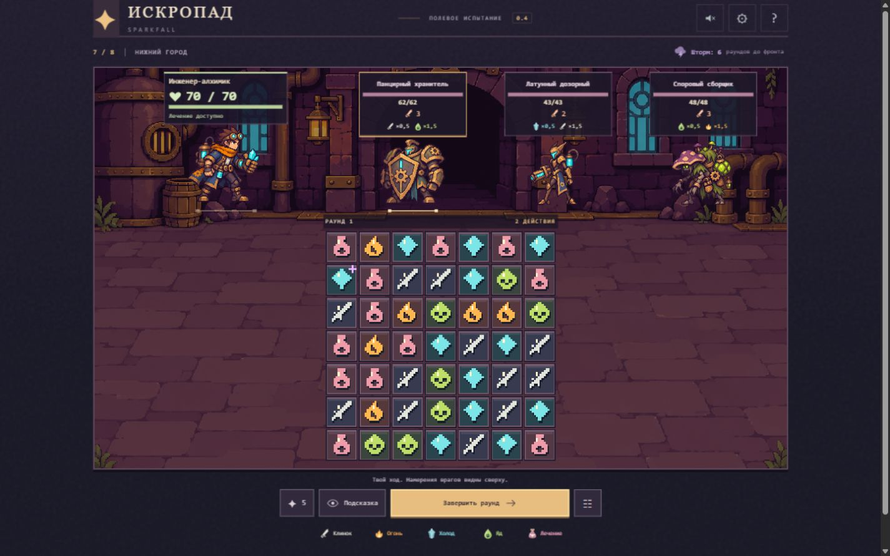
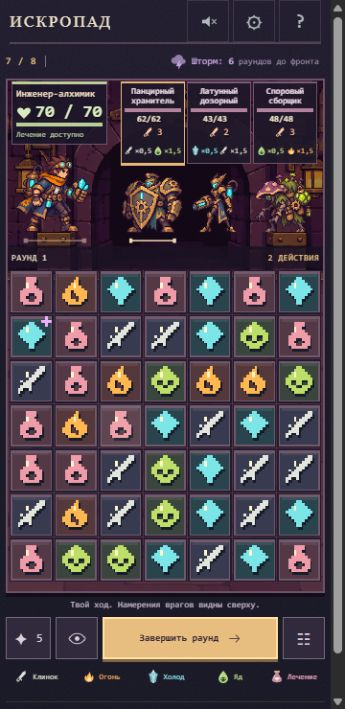
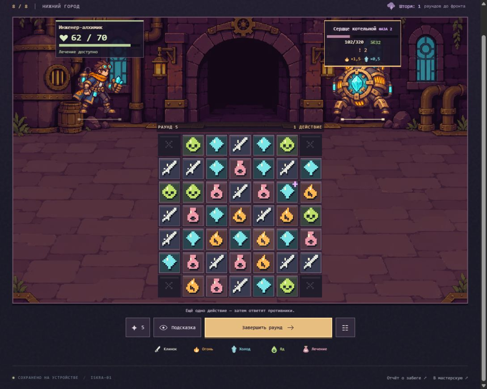
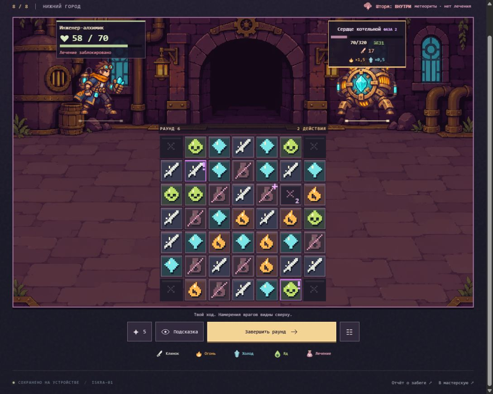

# Проверка итерации 2 — версия 0.4.0

Дата: 14 ноября 2026. Контракт: [ITERATION_2.md](ITERATION_2.md). Рабочая папка — `sparkfall`. Проверки интерфейса выполнены в браузере; тестовый профиль использовал `127.0.0.1:4173`, основной профиль `localhost:4173` не сбрасывался.

## Автоматические проверки

- `npm test`: **72 / 72**, ошибок нет. Исходная база перед работой: 61 тест.
- Новое покрытие: лимит и масштабирование тройки, тройная ветка маршрута, миграция профиля и активного боя, совместимость старого отчёта, порядок кадров, промежуточные HP трёх ударов, озноб в момент эффекта, скорость и сохранение настроек, геометрия клеток и отсутствие пересечения HUD.
- Перед реализацией наблюдались ожидаемые падения тестов новых требований. Дополнительно воспроизведены и исправлены ошибки размеров клетки на узком окне и пересечение HUD на границе адаптивности. Проверки игрового поведения выполнялись по TDD.
- `npm run simulate -- 10`: 30 забегов, по 10 для каждого стартового набора; **30 побед**, все прошли босса. Среднее число обменов: катушка 43, термопара 44, игла 45. Это проверка достижимости и сохранения, не доказательство интересного баланса.
- Старый отчёт `browser-playthrough.json`: победа, 44 обмена, 68 HP, 59 решений. Воспроизведение 0.3 сохранено.
- Новый отчёт [browser-playthrough-0.4.json](browser-playthrough-0.4.json): победа, **43 обмена, 58 HP, 63 решения**, максимальный каскад ×4. `npm run replay -- docs/browser-playthrough-0.4.json` подтвердил тот же игровой результат.
- Синтаксис `app.js`, `scene.js`, `views.js` проверен через `node --check`.

## Что проверено в браузере

Полный маршрут `ISKRA-01`: автомат → дозорный → событие → хранитель → тюремщик → привал → тройка → Сердце котельной. Получены четыре награды; сборка: катушка, маховик, термопара, реторта, игольчатый клинок.

| Сценарий | Наблюдение |
|---|---|
| Three.js и пиксельные ассеты | Фон, герой, семь моделей врагов, поле и эффекты загружаются локально; WebGL-сцена видна |
| Герой и противники | Герой постоянно слева, враги справа, матрица ниже; HP, намерения, статусы и резисты видны одновременно |
| Три цели | Третья цель выбирается нажатием; рамка меняется, остаются два действия |
| Последовательный ответ тройки | Пропуск раунда: 70 → 62 HP, атаки 3 + 2 + 3; отдельные промежуточные HP дополнительно покрыты тестом |
| Настройки | 0,5× использована на обмене; 2× и уменьшение движения сохраняются после перезагрузки; затем движение возвращено |
| Мышь | Клики по клеткам, противникам и кнопкам; успешное перетаскивание клетки вниз в бою с боссом |
| Клавиатура | Успешный обмен двумя Enter по соседним клеткам; полный проход только клавиатурой не выполнялся |
| Перезагрузка во время удара | После перетаскивания страница обновлена при статусе «ДЕЙСТВИЕ…»: восстановилось одно оставшееся действие и 285 HP босса; обмен не повторился |
| Навигация во время показа | Кнопка возвращения в мастерскую отключена до окончания действия; не оставляет очередь показа без активной сцены |
| Элита | Цепи тюремщика видны на поле; бой закончен без зависания |
| Босс | Фаза 2 при прохождении половины HP, четыре отключённых угла, огонь ×1,5 и холод ×0,5 |
| Шторм | Метеорит создал кратер на два раунда, показал урон и блокировку лечения; зелья перечёркнуты |
| Лечение внутри шторма | Собрана группа лечения: HP осталось 58, в журнале «Шторм заблокировал лечение»; реторта всё равно добавила яд |
| Финал | Победа, 6 выигранных боёв, 43 обмена, +12 искр забега; отчёт экспортирован через интерфейс |
| Основной профиль | Обновлён без сброса: активный `ISKRA-ODOAIP`, 70 HP, то же исходное поле первого боя |
| Консоль | В конце полного прохода ошибок и предупреждений не обнаружено |

## Адаптивность

Проверены заданные окна. На 360×740 браузер оставил 345 CSS px под документ из-за полосы прокрутки. При этом горизонтального переполнения нет; главное поле и кнопка раунда доступны без прокрутки.

| Окно | Ширина документа | Клетка | Нижняя граница основных кнопок |
|---|---:|---:|---:|
| 360×740 | 345 px | 45,56 px | 688 px |
| 390×844 | 390 px | 48,56 px | 709 px |
| 768×900 | 768 px | 51,42 px | 803 px |
| 1440×900 | 1425 px | 51,42 px | 836 px |

У трёх противников карточки состояния не перекрываются. Футер и второстепенные сведения могут требовать прокрутки на коротком окне. В конце проверки временное изменение размера браузера сброшено.

## Практические сценарии для следующего тестировщика

1. В ⚙ сравнить одинаковые по смыслу ходы на 0,5× / 1× / 2×; проверить, видно ли источник и получателя каждого удара. Включить уменьшение движения и убедиться, что паузы остаются.
2. В **новом** забеге выбрать левую ветку седьмого узла. Выбрать каждого из трёх врагов, проверить намерения и бесплатную смену цели. Старый перенесённый забег сохраняет прежнюю пару.
3. На телефоне сделать два нажатия и свайп; не попасть в соседнюю клетку случайно. Повернуть телефон, проверить сохранение выбора и отмену начатого жеста.
4. Обновить страницу во время длинного каскада. Проверить единственный результат и отсутствие переброса награды.
5. Затянуть бой до шторма: увидеть метеорит, кратер и отсутствие лечения. Дойти до второй фазы босса и проверить новую геометрию.

## Что ещё требует проверки

Физический телефон, реальные касания, мобильный Safari, слабый GPU, звук на устройстве и полный проход экранным диктором не проверены. Потеря WebGL-контекста обработана в коде, но принудительный сбой GPU в браузере не воспроизводился. Длительность человеческих забегов и удобство мелких подписей тройки следует оценить с друзьями.

Персонажи сейчас анимируются движением целого спрайта, выпадом и реакцией. Отдельных рисованных кадров атаки пока нет. Новые враги, биомы и постоянные бонусы к силе не добавлялись.

## Переносимая сборка

`npm run package` подготовил каталоги 0.4.0; собраны ZIP для локального запуска и статического хостинга, по 13,42 MiB. Для каждого архива все 31 файл `public/` сверены с исходниками по SHA-256. В упаковку входят оба модуля Three.js, MIT-лицензия, версия библиотеки и новые изображения.

Сервер из упакованного `playtest/` запущен на отдельном порту 4174: HTML, приложение, сцена, оба модуля Three.js, оба PNG и CSS ответили HTTP 200 с правильным MIME. Проверочный сервер остановлен; основной предпросмотр на 4173 оставлен работающим. Ссылки новой документации проверены.

## Снимки

