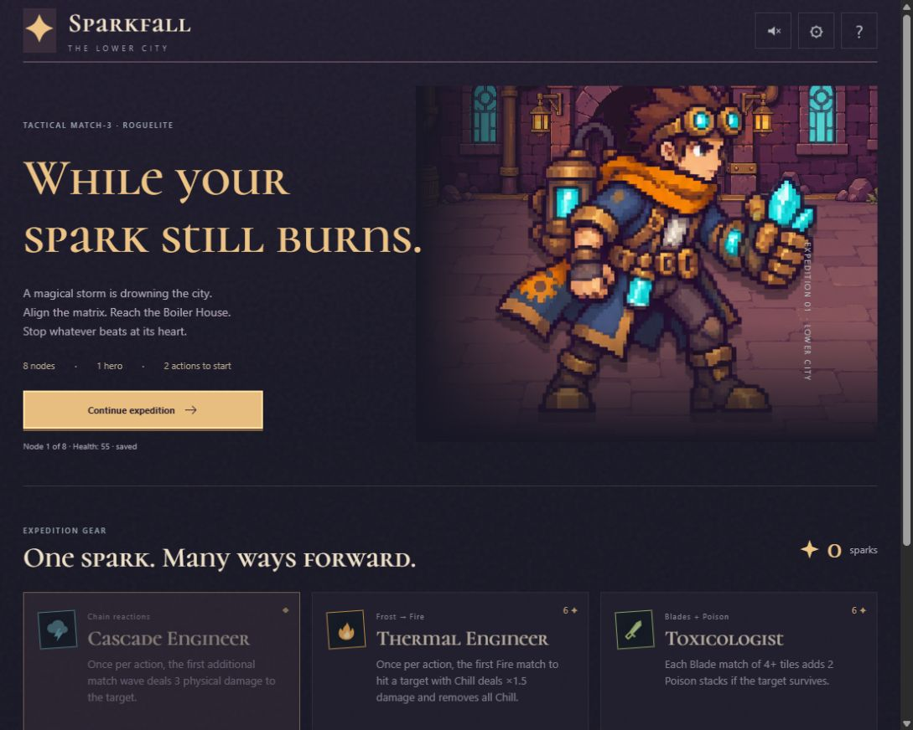
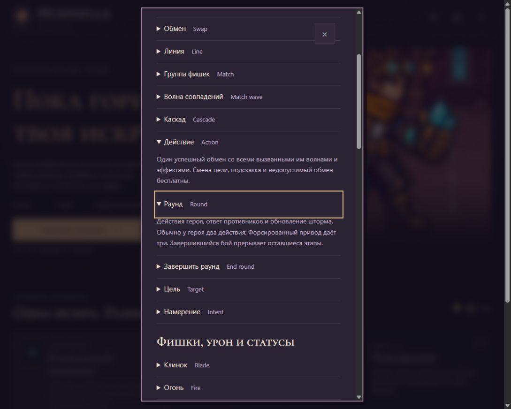

# Проверка локализации и типографики

Дата: 14 ноября 2026 года. Требования: [L01–L04](LOCALIZATION.md). Версия игровых правил — 0.5.0, без изменения баланса и формата сохранений.

## Результат

Полный RU/EN, отдельная настройка языка, единый словарь из 56 терминов в игре и документации. Заголовки и названия карточек используют локальный Cormorant Unicase 600; описания, кнопки и числа — обычный читаемый шрифт. Английская мастерская оставлена в локальном предпросмотре. Публикация в рамках этой задачи не выполнялась.

## Автоматические проверки

- Исходная база: 104 успешных теста. После реализации: `npm test` — **118 успешных, 0 ошибок**.
- 14 сценариев в `test/localization.test.js`: нормализация и сохранение языка; старые и повреждённые настройки; отказ хранилища; полнота парных каталогов и параметров; весь контент и экраны, включая старый вид карты, все события и привал; десятичные числа и формы для 0/1/2/5/11/21/22; запасной RU-перевод; ошибки отсутствующих ключей и параметров; повторный перевод событий, объявлений диктора и ошибок отзыва; точная синхронизация глоссария; неизменность боевого состояния и отчёта; имя скачиваемого JSON.
- Существующие тесты правил, миграций, реплеев 0.3/0.4/0.5, отзыва, путей и упаковки проходят. Проверка путей дополнена ссылкой на локальный шрифт в `typography.css`.
- `node scripts/glossary.mjs --check` подтверждает совпадение документа с игровым источником.
- Проверка таблицы `cmap` TTF подтвердила 133 символа: русский алфавит с `Ёё`, латиницу, цифры и используемую пунктуацию, включая `−` и `×`. Размер шрифта — 763 128 байт. Локальный сервер отдаёт его с HTTP 200 и типом `font/ttf`.
- `npm run package` создаёт статическую и локальную сборки; файлы локализации, шрифт и OFL входят в обе. Все 50 публичных файлов каждой сборки побайтово совпадают с исходниками; инструкция тестировщика также обновлена.
- `git diff --check` — без ошибок пробелов. История Git не изменялась.

При разработке зафиксированы содержательные красные и зелёные стадии: отсутствие сохранённого языка, переводов и склонений; русские строки в английских экранах; обращение к несуществующему типу фишки при форматировании чужого события; отсутствующее имя отчёта; устаревший документ словаря; невозможность повторно перевести объявление и сохранённую ошибку. Проверки не привязаны к декоративным CSS-классам.

## Браузер

Локальный HTTP-предпросмотр, Chromium во встроенном браузере. Проверены:

1. RU/EN в мастерской и в бою, английская карта. Заголовок страницы, язык документа, названия, кнопки, подсказки и подписи доступности меняются вместе с языком. Перезагрузка сохраняет English.
2. Законный обмен двумя нажатиями: урон и расход действия отображаются, журнал содержит английские названия и значения.
3. Смена языка в активном бою: JSON отчёта до и после совпал; здоровье и поле не изменились. Повторный перевод сохранённых записей журнала подтверждён автотестом.
4. Настройки во время разрешения действия: язык заблокирован до конца анимации и разблокируется в уже открытом окне. Проверена смена языка после разблокировки.
5. Справка, словарь из настроек и справки. Термины раскрываются мышью и Enter; определения «Действие» и «Раунд» различаются, присутствует соответствие на втором языке.
6. Английская форма отзыва и предупреждение о передаче данных; реальная отправка не выполнялась.
7. Скачивание JSON после исправления: создан `sparkfall-ISKRA-01.json`. Найденный `ReferenceError: r is not defined` исправлен через `reportFilename()` и регрессионную проверку. В конце сессии новых ошибок консоли не было; в истории осталась исходная запись до исправления.
8. Мастерская RU/EN при ширинах окна 360, 390, 768 и 1440 px; длинные названия и диалоги. Дополнительно карта и бой проверены на узких экранах. Горизонтальной прокрутки в проверенных экранах нет. На ширине 390 px клетка поля имеет сторону примерно 48,6 px. Проверены невысокие окна 768 × 700 и 1440 × 720. Временный размер окна сброшен.

Во время проверки также исправлены два дефекта повторного перевода: старое объявление здоровья для диктора и сохранённое сообщение об ошибке отзыва больше не остаются на предыдущем языке.

## Сценарии для тестировщика

1. Выбрать English в `⚙`, перезагрузить страницу, продолжить экспедицию. Проверить язык без потери прогресса.
2. Сохранить отчёт, переключить RU → EN → RU без игровых действий, сохранить снова. JSON должен совпасть; старые записи журнала должны читаться на выбранном языке.
3. Начать действие и сразу открыть настройки. Язык заблокирован во время анимации, затем доступен без закрытия окна.
4. Открыть словарь через `?` и `⚙`, прочитать пары «Зелье / Potion», «Холод / Frost», «Озноб / Chill», «Волна совпадений / Match wave» и «Каскад / Cascade». Сверить с описаниями предметов и журнала.
5. На телефоне и при масштабе 200% проверить заголовки, длинные названия артефактов, доступность закрытия диалога и кнопок боя. Текст не должен обрезаться или требовать горизонтальной прокрутки.
6. Проверить награды, все события и финал на английском в живой экспедиции. Автоматический рендер этих экранов покрыт; новый полный браузерный проход до босса в этой задаче не выполнялся.

## Ограничения

- Физический телефон, настоящие касания, мобильный Safari и слабый GPU не проверялись. Узкое окно не заменяет устройство.
- Масштаб браузера 200% не подтверждён: встроенный браузер не изменил масштаб после клавиатурных команд. Проверка ширин выполнена отдельно.
- Доступность проверена по подписи элементов и управлению словарём с клавиатуры; полный проход настоящим экранным диктором не выполнялся.
- Полный повторный тест доставки отзывов не запускался; сетевые сценарии проверены существующими тестами с подставным отправителем.

## Редакторская правка 15 ноября 2026 года

По замечанию пользователя проверен весь словарь RU/EN. Открытая вкладка показывала ранний текст с заметкой «„Тик“ оставить техническому обсуждению», хотя в исходнике эта фраза уже отсутствовала. Перезагрузка и повторное открытие определения подтвердили обновление.

Уточнено объяснение урона ядом; определения завершения раунда, лечения, стартового набора и отчёта переписаны для игрока. В контракте закреплено: редакторские указания остаются в документации, а игровые определения объясняют механику и последствия. `docs/GLOSSARY.md` обновлён из того же источника; 14 тестов локализации проходят. Статическая и локальная сборки пересобраны.
