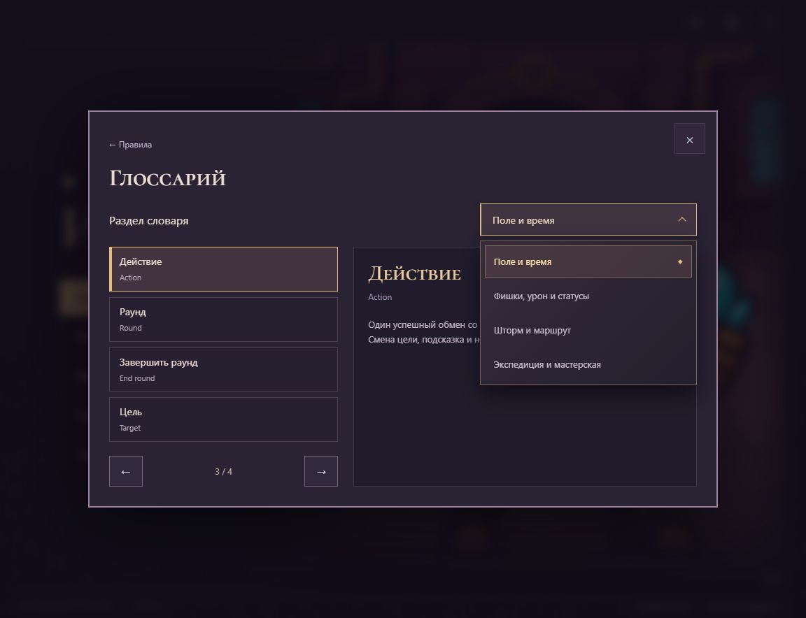
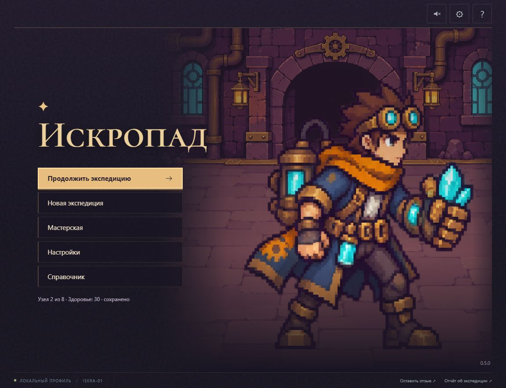
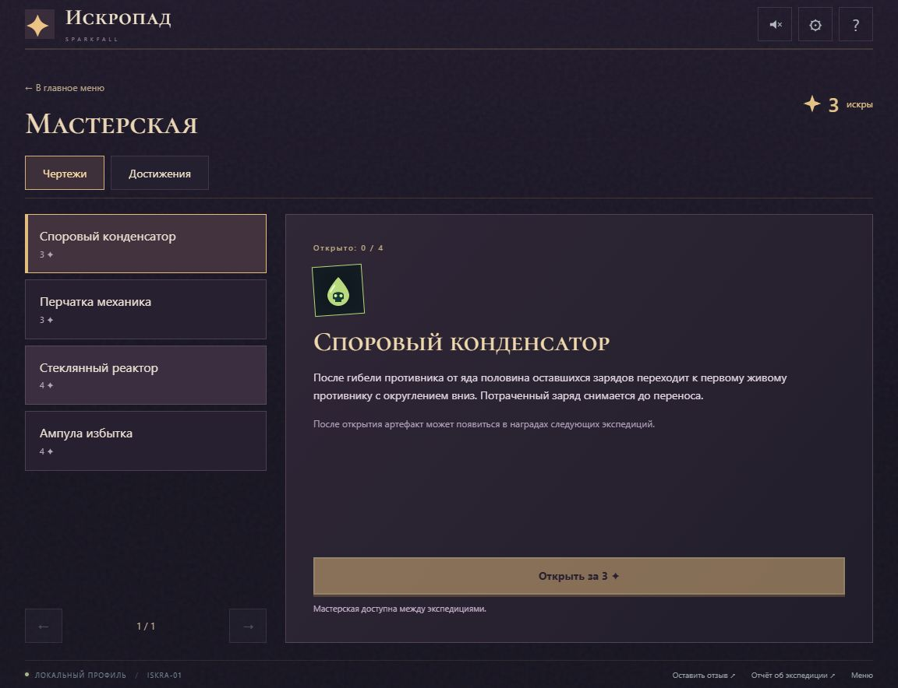
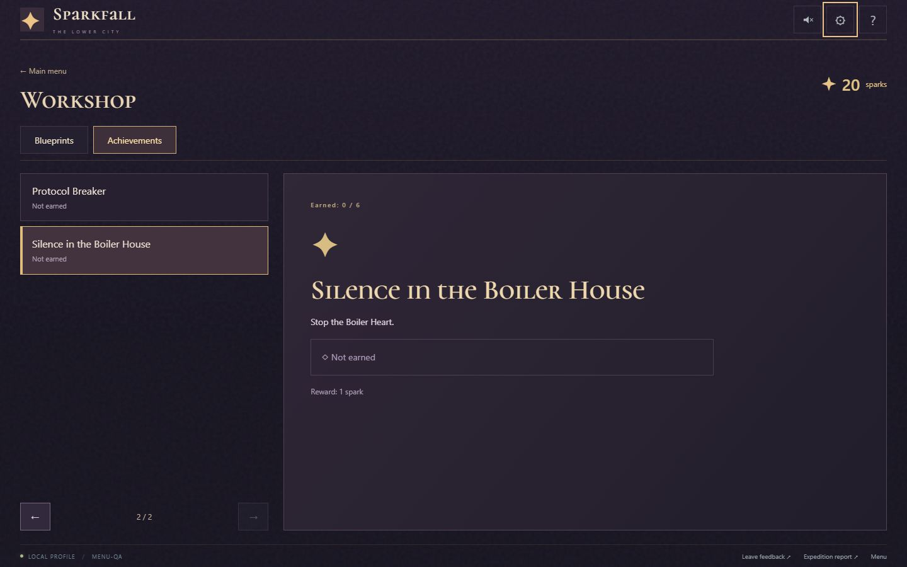
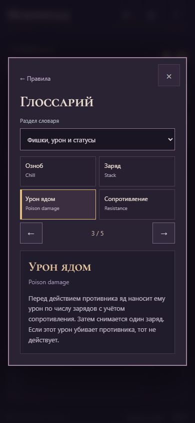

# Проверка игрового меню

Дата: 15 ноября 2026 года. Контракт: [N01–N05](MENUS.md).

## Выполненные проверки

- `npm test`: 125 тестов, все проходят. Семь проверок навигации добавлены через ожидаемое падение → реализацию → успешный прогон. Проверяются независимость от сессии, повторные покупки, страницы, контекст вкладок, ограничения графа и доступ к итогам.
- `npm run glossary -- --check`: документ синхронизирован с 56 игровыми терминами.
- `git diff --check`: ошибок пробелов нет.
- `npm run package`: обе сборки обновлены; 53 публичных файла в каждой побайтно совпадают с исходниками, каталог `_dev` отсутствует.
- Встроенный Chromium: 1152 × 884, 1280 × 720, 1440 × 900 и 390 × 844. На проверенных экранах документ не прокручивается, кнопки доступны, текст карточек не обрезан. Проверены размеры документа и границы содержимого, а не только скрытие полосы прокрутки.
- На 1280 × 720 проверены главное меню, мастерская и бой после настоящего обмена: противник потерял 15 здоровья, осталось одно действие. Нижние кнопки и легенда помещаются в окно.
- На 390 × 844 проверены подготовка, мастерская, карта, награда, событие, результат, настройки, все шесть страниц правил, длинное определение урона ядом, форма отзыва и бой с тремя противниками.
- На отдельном профиле куплены два чертежа подряд: баланс 20 → 17 → 14, открытый раздел и выбранный предмет сохранились. Проверены страницы достижений, переход между вкладками стрелками и сохранение второй страницы после возврата и смены языка.
- Просмотр восьмого этапа не разрешает вход из первого. Выбор награды переводит к следующему этапу, добавив именно выбранный артефакт.
- Escape открывает главное меню, «Продолжить» возвращает к бою. Отмена предложения завершить экспедицию сохраняет её. Перезагрузка открывает главное меню с прежним забегом.
- Отзыв: переход к отправке, отдельный просмотр JSON, возврат к сообщению и повторный переход сохраняют текст и галочку вложения. Во время этой проверки сообщения не отправлялись.
- В консоли проверочного профиля ошибок и предупреждений нет.

Покупки и постановочные состояния награды, события, итогов и тройного боя проверялись на отдельном порту 4186 через временную страницу `public/_dev/menus.html`. Этот каталог исключён из Git и сборок. Постановочные состояния используются для проверки интерфейса, а не как доказательство прохождения забега.

Исходная вкладка на порту 4175 обновлена. Сохранились узел 2, здоровье 30, 3 искры, 3 достижения и ключ ISKRA-01. Тестовые покупки её профиль не затрагивали.

## Практические сценарии для QA

1. Между экспедициями накопить минимум 6 искр. В «Мастерской → Чертежи» купить конденсатор и перчатку подряд. После каждой покупки остаётся та же карточка; открытый чертёж нельзя купить снова.
2. Открыть вторую страницу достижений, выбрать «Тишину в котельной», перейти в чертежи и обратно. Сохраняются страница и выбор. Повторить после RU → EN.
3. Начать экспедицию, выполнить обмен, нажать Escape и продолжить. Сравнить поле, здоровье и число действий. В главном меню выбрать новую экспедицию и отменить подтверждение — предыдущая остаётся доступна.
4. Осмотреть будущий этап карты: переход недоступен. Вернуться к текущему, выбрать связанный узел и войти. После награды убедиться, что открывается следующий этап.
5. В окнах 1280 × 720 и 390 × 844 пройти меню, подготовку, мастерскую, справочник и настройки. Не должно быть прокрутки документа или скрытых снизу кнопок.
6. В форме отзыва написать текст, перейти далее, включить вложение, открыть его просмотр и вернуться. Текст и выбор должны сохраниться; отправка выполняется только собственной кнопкой.
7. Завершить забег, вернуться в главное меню и открыть «Итоги экспедиции». Результат доступен до начала следующего забега.

## Ограничения

Узкий viewport не заменяет физический телефон. В этом изменении не проверялись экранная клавиатура, мобильный Safari, масштаб 200% и настоящий экранный диктор. Полный новый забег до босса не проходился: игровое ядро не менялось, его проверки и воспроизведение прежних отчётов входят в общий набор тестов.

## Снимки

### Уточнение: список разделов глоссария

15 ноября системный select заменён панелью в стиле игры. Раскрытие и сворачивание используют переходы 160–180 мс, содержимое словаря появляется мягко. Настройка уменьшения движения отключает оба эффекта; это проверено через интерфейс настроек и вычисленные стили (`0s`, `animation: none`).

В Chromium проверены 1152 × 884 и 390 × 844, RU/EN, выбор мышью, стрелки, Home/End, Enter, пробел, Tab, поиск по первой букве и нажатие снаружи. Escape отменяет неподтверждённое выделение и закрывает только список; следующее нажатие закрывает глоссарий. Повторный выбор текущего раздела сохранил страницу 2 / 5; смена раздела вернула страницу 1. Панель полностью помещается внутри диалога и не меняет его размер. Настоящий экранный диктор и физическое касание не проверялись.

Все 125 тестов проходят, ошибок в консоли нет. Сборки пересобраны. Исходные настройки RU и обычной анимации восстановлены, вкладка оставлена на странице 3 / 4 раздела «Поле и время» с раскрытым списком.

